# Authentication and Authorization Architecture

This document explains the authentication lifecycle, session persistence, token verification, and security controls across the web client, mobile WebView, and Express backend.

---

## 1. Authentication Lifecycle

```mermaid
sequenceDiagram
    autonumber
    actor Pilot as User / Mobile WebView
    participant Client as Frontend (Website / Auth.js)
    participant SupaAuth as Supabase Auth (GoTrue)
    participant Backend as Express REST API
    participant DB as PostgreSQL (profiles table)

    Pilot->>Client: Enters email and password / Clicks Sign In
    Client->>SupaAuth: POST /auth/v1/token?grant_type=password
    SupaAuth-->>Client: Returns JWT access_token, refresh_token, user_metadata
    Note over Client: Stores tokens securely in localStorage

    Pilot->>Client: Edits bio & clicks "Save Profile"
    Client->>Backend: PATCH /api/v1/profile/me (Header: Bearer access_token)
    
    rect rgb(20, 30, 45)
    Note over Backend: Middleware: requireAuth
    Backend->>SupaAuth: supabaseAdmin.auth.getUser(access_token)
    SupaAuth-->>Backend: Returns verified User Claims (id: "uuid-1234")
    Backend->>Backend: Injects req.user = { id: "uuid-1234" }
    end

    Backend->>Backend: Zod schema validation (updateProfileSchema)
    Backend->>DB: UPDATE profiles SET ... WHERE id = 'uuid-1234'
    Note over DB: Fires BEFORE UPDATE trigger (updated_at)
    DB-->>Backend: Returns updated profile row
    Backend-->>Client: 200 OK { success: true, data: profile }
    Client-->>Pilot: Displays updated profile & live trigger timestamp
```



---

## 2. JWT Access Token Verification & Security Guardrails

### A. Strict Token Claim Extraction
The frontend **never** supplies the target user ID in query strings or JSON payloads.
The backend extracts identity strictly from the verified cryptographically signed JWT:

```typescript
// backend/src/middleware/auth.ts
const { data: { user }, error } = await supabaseAdmin.auth.getUser(token);
if (error || !user) {
  return res.status(401).json({ success: false, error: 'Unauthorized: Invalid token' });
}

// Trusted identity attached to request context
req.user = { id: user.id, email: user.email };
```

### B. Prevention of Horizontal Privilege Escalation
Because queries are hardcoded to `WHERE id = req.user.id`, User A can **never** read or update User B's profile, even if they inspect network traffic and attempt to inject a different user UUID.

---

## 3. WebView and OAuth Considerations

When rendering OAuth providers (like Google OAuth) inside an embedded mobile WebView:
1. **Google's Policy:** Google blocks OAuth inside standard embedded WebViews (`disallowed_useragent`) to prevent phishing.
2. **Mitigations Implemented:**
   - **Custom Mobile User-Agent:** The Android WebView in `android-app/src/app/index.tsx` specifies:
     `Mozilla/5.0 (Linux; Android 14; Mobile) AppleWebKit/537.36 (KHTML, like Gecko) Chrome/126.0.0.0 Mobile Safari/537.36`
   - **External Browser Handoff:** For full production hardening, deep links via `Linking.openURL()` and Expo `WebBrowser.openAuthSessionAsync()` can hand off authentication to Chrome Custom Tabs, returning via deep-link scheme `nexorarobotics://auth/callback`.

---

## 4. Session Persistence and Expiration

- **Client Storage:** Supabase Auth persists sessions in `localStorage`.
- **Automatic Refresh:** The Supabase client automatically issues refresh requests to renew short-lived JWT access tokens (default 1-hour expiry) before they expire.
- **Graceful Error Handling:** If a token expires while offline, the backend returns `401 Unauthorized`. The frontend prompts the user to re-authenticate without corrupting state.
