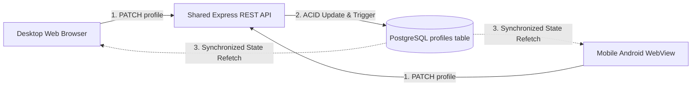

# Cross-Client Data Synchronization

This document explains the synchronization mechanics between the website, mobile app (WebView), and Supabase PostgreSQL.

---

## 1. The Core Architecture: Single Source of Truth

Neither client maintains an independent local SQLite or AsyncStorage database for profile records. Instead:
- Both clients communicate over HTTPS with the **same remote backend API** or **same Supabase database**.
- Any modification instantly updates the single authoritative record in PostgreSQL.
- Both clients retrieve from that exact row.

---

## 2. Distinguishing Key Technical Concepts

Senior developers frequently ask candidates to differentiate these 4 layers:

| Concept | What It Actually Is | How Implemented in this Project |
|---|---|---|
| **1. Persisting Data in Database** | Committing bytes durably to disk using an ACID transaction. | Executing SQL `UPDATE public.profiles` on Supabase PostgreSQL. Data survives browser refreshes, app restarts, and cache invalidation. |
| **2. Refreshing a Client Interface** | Re-requesting the state from the network and re-rendering React/DOM elements. | Clicking **"Force Sync Now"**, app pull-to-refresh, window refocus, or periodic polling interval (15s). |
| **3. Real-Time Notification** | Push-based event delivery over a persistent TCP connection (WebSocket/SSE). | Supabase Realtime channel (`postgres_changes` on table `profiles`). |
| **4. Database Trigger Execution** | Procedural code running inside the PostgreSQL engine itself upon an INSERT, UPDATE, or DELETE. | `trigger_set_profiles_updated_at` calculates the server-side UTC timestamp whenever a row is modified. |

---

## 3. Bidirectional Verification Walkthrough

### Flow A: Web Browser ➡️ Mobile App
1. Open the website on your desktop browser (`index.html`).
2. Log in with your pilot credentials.
3. Open the **Pilot Profile** modal. Change the bio to: `"Updated from Desktop Web at 10:45 AM"`.
4. Click **Save & Sync to Database**.
5. Observe:
   - Green confirmation toast appears.
   - The `Last Database Sync` timestamp updates instantly via the PostgreSQL trigger.
6. Now switch to the Android device / WebView app.
7. Open the profile or tap **"Force Sync Now"**.
8. **Result:** The bio immediately displays `"Updated from Desktop Web at 10:45 AM"` with the exact same updated timestamp.

### Flow B: Mobile App ➡️ Web Browser
1. In the Android WebView app, edit the hobbies field to: `"Autonomous Roaming, Cybernetics"`.
2. Click **Save & Sync to Database**.
3. Inspect the Supabase dashboard in your browser (`Table Editor -> profiles`). The `hobbies` column reflects the new values.
4. Refresh or click **"Force Sync Now"** on the desktop web browser.
5. **Result:** The desktop browser immediately shows `"Autonomous Roaming, Cybernetics"`.
